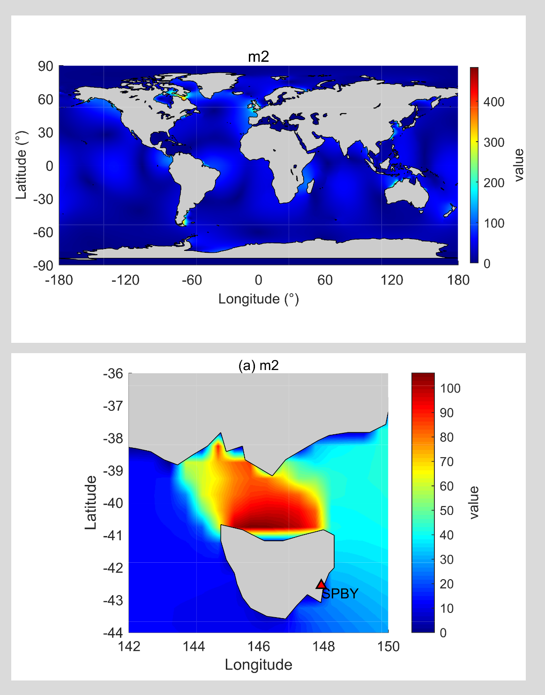

# NAO.99b Sea Tide Model: Distribution Maps of Amplitude or Lag Angle in Global and Local Areas

As illustrated in the previous section with M2, we have created a global amplitude distribution and a localized amplitude distribution map. The diagram is based on MATLAB 2021b version and the amplitude data generated above. This tutorial is not easy to create, but if you need this part of the drawing tutorial, thank you for your support:

\n        \n

## Images

<!-- PAYMENT_BLOCK -->

## Get this dataset

- Payment link (Stripe): [Buy now](https://buy.stripe.com/3cs8yP7sY87d0vu9AB)
- Payment QR code: 

<!-- /PAYMENT_BLOCK -->
